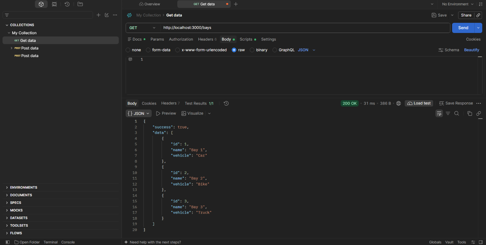
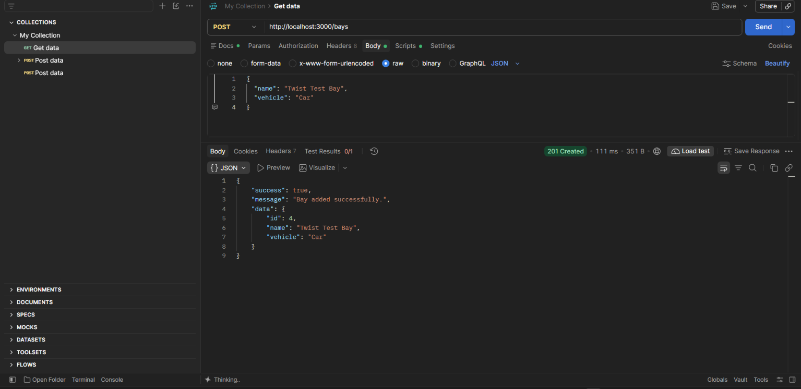
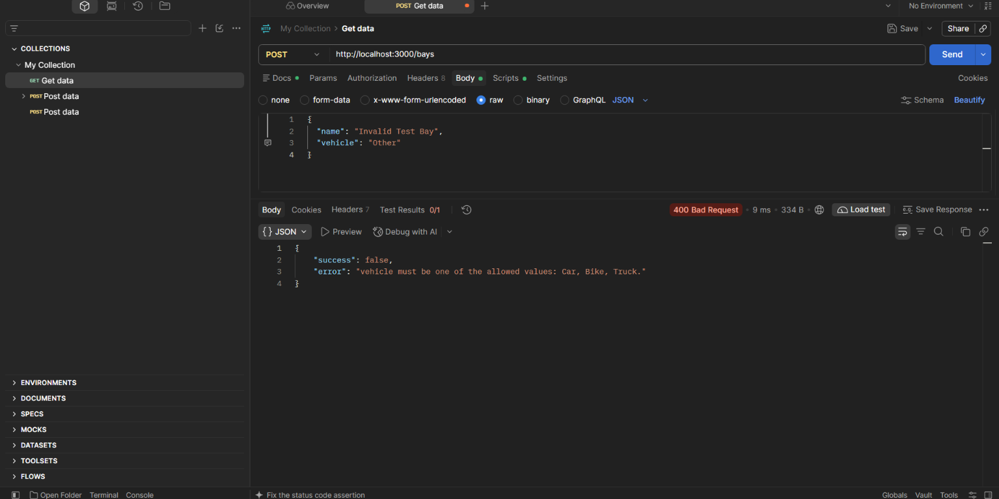
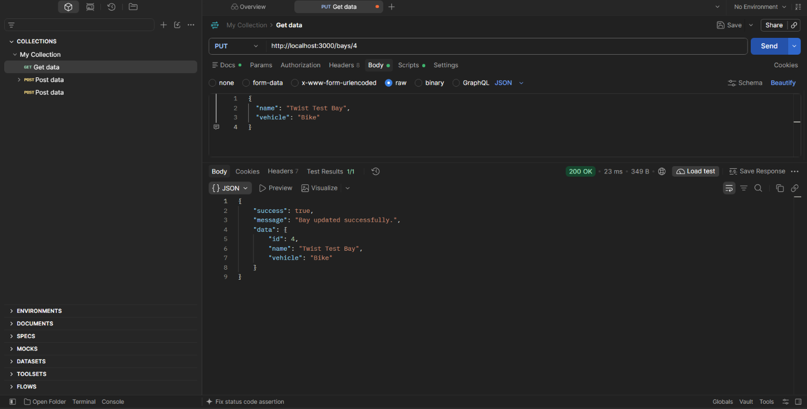
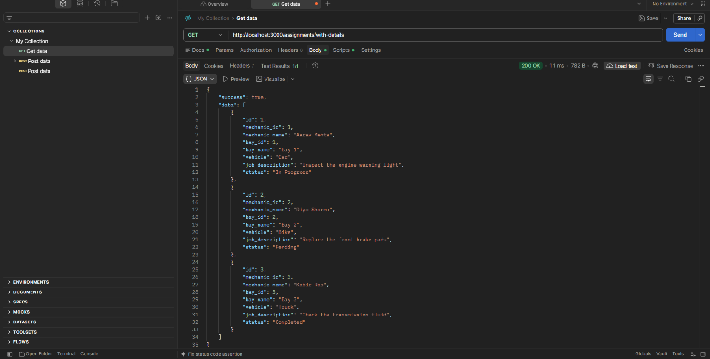
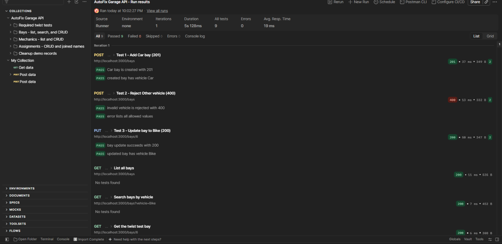
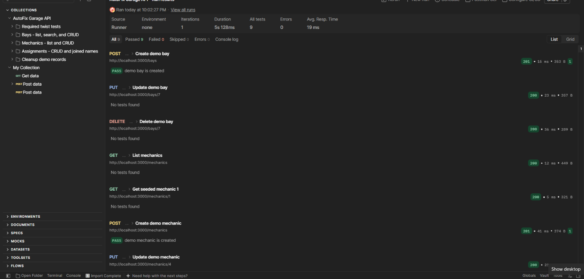
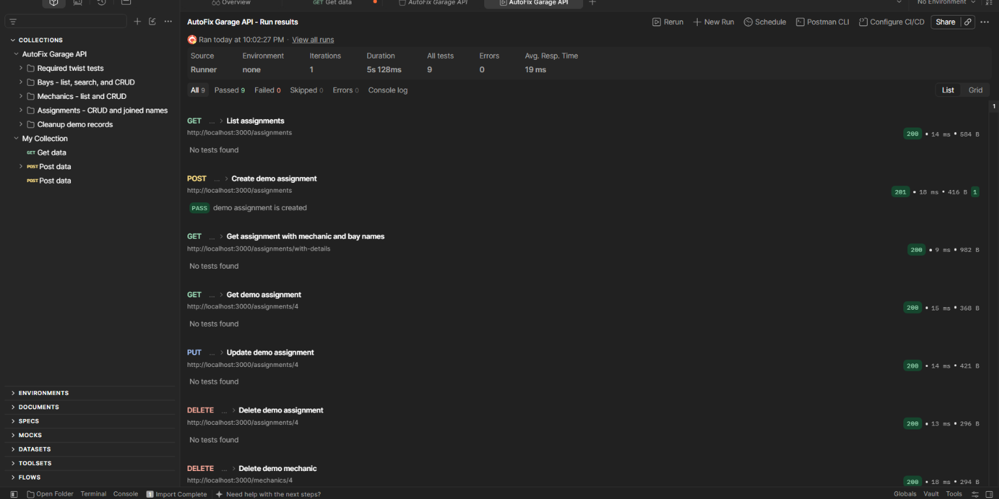

# AutoFix Garage

AutoFix Garage is a small backend API for managing service bays, mechanics, and repair assignments. It uses beginner-level CommonJS JavaScript, Express, and SQLite to meet the client brief requirements.

## Group members and responsibilities

| No. | Group member | Registration number | Responsibility |
| --- | --- | --- | --- |
| 1 | Namrata |252U1R5111  | Express server, app routing, and README: starts the API, connects the resource routers, and explains how to run the project. |
| 2 | Bhagya |252U1R5108  | Bay and mechanic REST endpoints: handles CRUD requests and bay search by vehicle. |
| 3 | Sagarika |252U1R5115  | Assignment REST endpoints: handles assignment CRUD and the join that shows mechanic and bay names. |
| 4 | Sirisha |252U1R5109  | SQLite database: explains the three tables, primary keys, foreign keys, constraints, and sample records. |
| 5 | Sarika |252U1R5096  | Validation and API checks: explains allowed values and error messages, and demonstrates the twist tests and Postman collection. |

## Client brief requirements

| Requirement from the brief | How this project meets it |
| --- | --- |
| Express server with routes for bays, mechanics, and assignments | `server.js` starts the server; `src/app.js` mounts one router for each resource. |
| Three related SQLite tables | `mechanics`, `bays`, and `assignments` are created in `src/database.js`. Assignments contain foreign keys to mechanics and bays. |
| GET, POST, PUT, and DELETE operations | The three resource routers provide create, read, update, and delete operations. |
| Show assignment with mechanic and bay names | `GET /assignments/with-details` joins the three tables and returns the related names. |
| Validate additions and updates with clear errors | Routes check required text, IDs, vehicle types, related records, and assignment status before writing to SQLite. Invalid input returns HTTP 400 with an explanation. |
| Search bays using a query parameter | `GET /bays?vehicle=Car` filters bays by vehicle. Only `Car`, `Bike`, and `Truck` are accepted. |
| Vehicle twist tests | The API accepts `Car` (201), rejects `Other` (400 and lists allowed values), and updates a bay to `Bike` (200). |
| GitHub, Postman collection, and README hand-in | This repository contains the source, `postman/AutoFix Garage.postman_collection.json`, and this README. |

The required twist values are case-sensitive: `Car`, `Bike`, and `Truck`. Another value, such as `Other`, must be rejected with HTTP 400 and a message listing all three allowed values.

## Project files

```text
server.js                                      Starts the API and opens SQLite
src/app.js                                     Serves the garage website and mounts API routers
src/database.js                                Creates tables, constraints, and sample rows
src/helpers.js                                 Shared input checks and JSON error helper
src/routes/bays.js                             Bay CRUD and vehicle search
src/routes/mechanics.js                        Mechanic CRUD
src/routes/assignments.js                      Assignment CRUD and SQL join
public/index.html                              AutoFix Garage dashboard page
public/styles.css                              Dashboard layout and responsive styles
public/app.js                                  Dashboard forms, search, and API requests
public/garage-hero.svg                         Garage hero illustration
test/api.test.js                               11 automated API checks using node:test
postman/AutoFix Garage.postman_collection.json Importable Postman requests and assertions
docs/postman-screenshots/                   Screenshots of the API responses and Postman run
data/autofix.sqlite                            Created locally on first normal server start
```

The SQLite file is generated at `data/autofix.sqlite` and is ignored by Git. On the first start with an empty database, the app inserts three sample mechanics, three bays, and three assignments. Restarting the server keeps existing data and does not add duplicate sample rows. Automated checks use an in-memory database.

## Install and run

Use Node.js 20 or later. Open a terminal in the project folder and run:

```sh
npm install
npm start
```

The AutoFix Garage website and API run at **http://localhost:3000**. Open that address in a browser to use the garage dashboard. The API routes such as `/bays`, `/mechanics`, and `/assignments` stay available for Postman. Leave this terminal open while using the site or Postman. Press `Ctrl+C` to stop the server. To run the automated checks in a second terminal, use:

```sh
npm test
```

## Live deployment

- **Website:** [https://autofix-garage-backend.onrender.com/](https://autofix-garage-backend.onrender.com/)
- **API welcome:** [https://autofix-garage-backend.onrender.com/api](https://autofix-garage-backend.onrender.com/api)
- **Health check:** [https://autofix-garage-backend.onrender.com/health](https://autofix-garage-backend.onrender.com/health)

The free Render service may sleep after inactivity, so the first page load can take longer. The Postman collection defaults to the local address; set its `baseUrl` variable to `https://autofix-garage-backend.onrender.com` to send requests to the deployed API.

## API reference

The API base URL is `http://localhost:3000`. Requests with a body use JSON and the header `Content-Type: application/json`.

| Method | Path | Purpose |
| --- | --- | --- |
| `GET` | `/` | AutoFix Garage website |
| `GET` | `/api` | API welcome message and resource list |
| `GET` | `/health` | Health check |
| `GET` | `/bays` | List all bays |
| `GET` | `/bays?vehicle=Car` | Search bays by vehicle (`Car`, `Bike`, or `Truck`) |
| `GET` | `/bays/:id` | Read one bay |
| `POST` | `/bays` | Create a bay |
| `PUT` | `/bays/:id` | Replace a bay's name and vehicle |
| `DELETE` | `/bays/:id` | Delete a bay not used by an assignment |
| `GET` | `/mechanics` | List mechanics |
| `GET` | `/mechanics/:id` | Read one mechanic |
| `POST` | `/mechanics` | Create a mechanic |
| `PUT` | `/mechanics/:id` | Replace a mechanic's name and specialty |
| `DELETE` | `/mechanics/:id` | Delete a mechanic not used by an assignment |
| `GET` | `/assignments` | List assignments |
| `GET` | `/assignments/:id` | Read one assignment |
| `POST` | `/assignments` | Create an assignment |
| `PUT` | `/assignments/:id` | Replace an assignment's fields |
| `DELETE` | `/assignments/:id` | Delete an assignment |
| `GET` | `/assignments/with-details` | Join assignments with mechanic and bay names |

### Example request bodies

Create or update a bay:

```json
{
  "name": "North Service Bay",
  "vehicle": "Car"
}
```

Create or update a mechanic:

```json
{
  "name": "Sam Patel",
  "specialty": "Brake repair"
}
```

Create or update an assignment. `mechanicId` and `bayId` must refer to existing rows. If `status` is omitted, it defaults to `Pending`.

```json
{
  "mechanicId": 1,
  "bayId": 1,
  "jobDescription": "Inspect the brakes",
  "status": "Pending"
}
```

Allowed assignment statuses are `Pending`, `In Progress`, and `Completed`.

### Responses and status codes

Successful resource responses use JSON such as `{ "success": true, "data": ... }`. Error responses use `{ "success": false, "error": "..." }`.

| HTTP status | Meaning in this API |
| --- | --- |
| `200 OK` | A read, update, or delete succeeded. |
| `201 Created` | A bay, mechanic, or assignment was created. |
| `400 Bad Request` | JSON or an input field, ID, query value, or related record is invalid. |
| `404 Not Found` | The route or requested record does not exist. |
| `409 Conflict` | A mechanic or bay is still referenced by an assignment and cannot be deleted. |
| `500 Internal Server Error` | An unexpected server error occurred. |

## Postman: import and run the collection

The collection is **`postman/AutoFix Garage.postman_collection.json`**. It uses the collection variables `baseUrl`, `carBayId`, `demoBayId`, `mechanicId`, and `assignmentId`.

1. Start the API with `npm start` and keep the server terminal open.
2. Open Postman and select **Import**.
3. Choose `postman/AutoFix Garage.postman_collection.json` from this project folder.
4. Open the imported **AutoFix Garage API** collection and check that its `baseUrl` variable is `http://localhost:3000`.
5. Run the requests in order from top to bottom. The collection saves IDs returned by create requests, so later update, read, and delete requests can use them.
6. Open each response and its **Test Results** tab to show the status and assertions.

The collection's folders run in this order: **Required twist tests**, **Bays — list, search, and CRUD**, **Mechanics — list and CRUD**, **Assignments — CRUD and joined names**, and **Cleanup demo records**. The final cleanup removes the demo assignment, mechanic, and twist-test bay. If you stop partway through, run the cleanup requests only for IDs that were created.

All three required twist requests use **Body → raw → JSON**. The collection already includes the JSON header and request bodies.

### Required twist test 1 — add a `Car` bay

In Postman, set the method and URL as follows:

```http
POST {{baseUrl}}/bays
Content-Type: application/json
```

Select **Body → raw → JSON** and enter:

```json
{
  "name": "Twist Test Bay",
  "vehicle": "Car"
}
```

Expected: **201 Created**. The response includes the new bay in `data`; the collection saves its ID as `carBayId` for the next request.

### Required twist test 2 — reject `Other`

```http
POST {{baseUrl}}/bays
Content-Type: application/json
```

Body:

```json
{
  "name": "Invalid Test Bay",
  "vehicle": "Other"
}
```

Expected: **400 Bad Request**, with an error message containing `Car, Bike, Truck`.

### Required twist test 3 — update the bay to `Bike`

Run Test 1 first so `carBayId` has a value.

```http
PUT {{baseUrl}}/bays/{{carBayId}}
Content-Type: application/json
```

Body:

```json
{
  "name": "Twist Test Bay",
  "vehicle": "Bike"
}
```

Expected: **200 OK**, with `data.vehicle` equal to `Bike`.

### Exact Postman Tests script syntax

In Postman, open a request and use its **Scripts → Post-response** area (called **Tests** in older Postman versions). The collection already has these checks. A readable equivalent for Test 1 is:

```javascript
pm.test('Car bay is created with 201', function () {
  pm.response.to.have.status(201);
});

const body = pm.response.json();

pm.test('created bay has vehicle Car', function () {
  pm.expect(body.data.vehicle).to.eql('Car');
});

pm.collectionVariables.set('carBayId', body.data.id);
```

For Test 2, the collection checks that the response is 400 and the error lists all allowed values:

```javascript
pm.test('invalid vehicle is rejected with 400', function () {
  pm.response.to.have.status(400);
});

const body = pm.response.json();

pm.test('error lists all allowed values', function () {
  pm.expect(body.error).to.include('Car, Bike, Truck');
});
```

For Test 3, it checks the update status and resulting vehicle:

```javascript
pm.test('bay update succeeds with 200', function () {
  pm.response.to.have.status(200);
});

pm.test('updated bay has vehicle Bike', function () {
  pm.expect(pm.response.json().data.vehicle).to.eql('Bike');
});
```

`pm.test` defines a visible check in Postman's Test Results. `pm.response` reads the response, `pm.expect` checks a value, and `pm.collectionVariables.set` saves a value for later requests in the collection.

### Search, join, and CRUD examples

Search for bays that support `Bike`:

```http
GET {{baseUrl}}/bays?vehicle=Bike
```

The text after `?` is the query parameter. Change it to `Car` or `Truck` to search those types. `Other` returns 400.

Show assignment rows with related mechanic and bay names:

```http
GET {{baseUrl}}/assignments/with-details
```

Create a mechanic:

```http
POST {{baseUrl}}/mechanics
Content-Type: application/json
```

```json
{
  "name": "Postman Demo Mechanic",
  "specialty": "General repair"
}
```

The collection stores the returned ID in `mechanicId`. Create an assignment with the saved mechanic and bay IDs:

```http
POST {{baseUrl}}/assignments
Content-Type: application/json
```

```json
{
  "mechanicId": {{mechanicId}},
  "bayId": {{carBayId}},
  "jobDescription": "Inspect the demonstration vehicle",
  "status": "Pending"
}
```

The collection then stores the returned assignment ID as `assignmentId`. The remaining requests show list, read-one, update, and delete examples for the resources. To use a numeric ID manually, replace the variable in a path, for example `GET http://localhost:3000/bays/1`.

## Postman screenshot evidence

These screenshots show Postman responses and collection runs for the required vehicle checks, bay search, CRUD routes, and assignment join.

**List all bays**



**Search bays by vehicle**


**Create a Car bay (HTTP 201)**



**Reject an unsupported vehicle (HTTP 400)**



**Update a bay to Bike (HTTP 200)**



**Assignment join response**



**Required tests and bay requests in the collection runner**



**Bay and mechanic requests in the collection runner**



**Assignment requests in the collection runner**



## How the database and a route work

The database has three tables:

| Table | Main columns | Purpose |
| --- | --- | --- |
| `mechanics` | `id`, `name`, `specialty` | Stores mechanics. |
| `bays` | `id`, `name`, `vehicle` | Stores service bays; `vehicle` must be `Car`, `Bike`, or `Truck`. |
| `assignments` | `id`, `mechanic_id`, `bay_id`, `job_description`, `status` | Connects one mechanic and one bay to a job. |

Each assignment references one mechanic and one bay. One mechanic or bay may be referenced by multiple assignments. Foreign keys are enabled in SQLite, and delete routes return 409 if a mechanic or bay is still in use.

For example, `POST /bays` follows these steps:

1. Express parses the incoming JSON body.
2. The bay route checks that `name` is non-empty and `vehicle` is allowed.
3. The route inserts the bay with SQL placeholders (`?`) and passes the values separately.
4. The route reads the new row from SQLite.
5. The route returns the row as JSON with HTTP 201.

Parameterized SQL keeps submitted values separate from the SQL command. The assignment join uses SQL `JOIN` statements to retrieve mechanic and bay names alongside assignment fields.

## Automated checks

Run `npm test`. The Node.js built-in `node:test` suite covers 11 checks:

1. Creating a `Car` bay returns 201.
2. `Other` returns 400 and lists the allowed values.
3. Updating a bay to `Bike` returns 200.
4. Listing and searching bays works.
5. Invalid vehicle search is rejected.
6. Bay read, update, and delete work.
7. A missing bay name returns a clear 400.
8. The assignment join includes mechanic and bay names.
9. Mechanic create, read, update, and delete work.
10. Assignment create, read, update, and delete work.
11. A missing bay returns 404.
